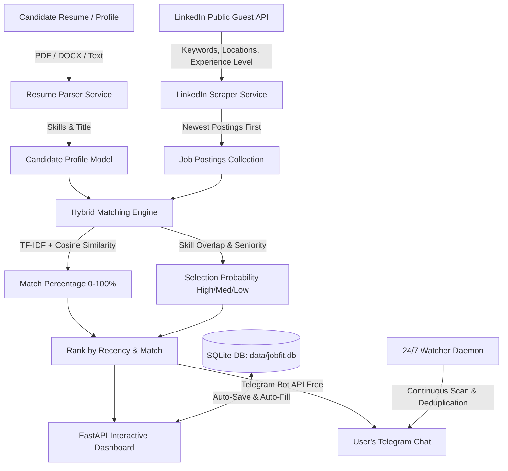

# 🚀 JobFit AI - Intelligent LinkedIn Job Matcher & Telegram Bot

[](https://www.python.org/)
[](https://fastapi.tiangolo.com/)
[](https://www.sqlite.org/)
[](https://scikit-learn.org/)
[](https://core.telegram.org/bots/api)

> **JobFit AI** is searches real-time active LinkedIn jobs without limits, computes deep ATS match percentages (0–100%) and selection probabilities, and broadcasts top matches directly to a Telegram bot.
>
> **100% Free & Local** — No paid LLM subscriptions, no OpenAI tokens, and no LinkedIn API keys required. Features built-in SQLite persistence and a 24/7 background watcher daemon.

---

## 📑 Table of Contents

- [Key Features](#-key-features)
- [How It Works (Matching Engine)](#-how-it-works-matching-engine)
- [System Architecture](#-system-architecture)
- [Tech Stack](#-tech-stack)
- [Quick Start Guide](#-quick-start-guide)
- [1-Minute Telegram Bot Setup](#-1-minute-telegram-bot-setup-100-free)
- [Running the Application](#-running-the-application)
- [Docker Deployment](#-docker-deployment)
- [API Reference](#-api-reference)
- [Step-by-Step: Push to GitHub](#-step-by-step-how-to-push-to-github)
- [Project Directory Structure](#-project-directory-structure)

---

## 🌟 Key Features

1. **Unlimited LinkedIn Guest Job Harvester**:
   - Searches active, real-time LinkedIn job postings across multiple pages with **no artificial limits** (fetches all available jobs).
   - Supports **up to 3 target locations** (e.g., *Remote*, *United States*, *India*) — location is completely **optional** (defaults to worldwide if omitted).
   - **Experience Level Filter**: Target *Entry Level*, *Associate / Mid*, *Mid-Senior*, *Senior*, *Director / Lead*, or *Internship*.
   - **Recency Prioritization**: Queries LinkedIn with `sortBy=DD` and sorts postings so the **newest job is the top priority**.

2. **Multi-Format Resume Parser & Smart Title Inference**:
   - Upload resumes in **PDF**, **DOCX**, or **TXT** format (or paste raw text).
   - Boundary-safe regex extractor identifies 60+ technical skills and estimates professional experience.
   - **Tailored Job Title Suggestions**: Automatically suggests 3 to 4 recommended target roles matching the resume stack.

3. **Hybrid ATS Matching Engine (Zero Cost)**:
   - **Skill Overlap Score**: Compares required vs. candidate skills using set theory.
   - **Contextual TF-IDF Similarity**: Computes semantic N-gram cosine similarity using Scikit-Learn.
   - **Experience Calibration**: Penalizes seniority mismatches (prevents showing Lead/Principal roles to freshers).
   - **Selection Probability**: Categorizes matches into `Very High`, `High`, `Moderate`, or `Low` likelihood of resume selection.

4. **Instant Telegram Alerts**:
   - Dispatches formatted HTML alert cards directly to your Telegram chat or channel.
   - Includes Match Badge, Company, Location, Date Posted, Experience Level, Matching Skills, Missing Skills, and a direct LinkedIn application link.

5. **Zero-Repetition SQLite Persistence**:
   - Auto-saves user profile, parsed resume, search preferences, and Telegram credentials to an embedded SQLite database (`data/jobfit.db`).
   - Automatically pre-fills the dashboard on page reload — no repeated uploads.

6. **24/7 Background Watcher Daemon**:
   - Autonomous server-side background task runs periodically (e.g., every 5–10 minutes) even when the browser is closed.
   - Compares findings against `data/sent_jobs.json` to deliver alerts **only for brand-new postings** with zero duplicate spam.

---

## 🧠 How It Works (Matching Engine)

JobFit AI does not require heavy, costly cloud LLMs. It uses high-speed, deterministic Machine Learning & Information Retrieval algorithms:

$$\text{Match Percentage} = (0.50 \times \text{Skill Overlap}) + (0.35 \times \text{TF-IDF Cosine Similarity}) + (0.15 \times \text{Title Alignment}) \pm \text{Seniority Adjustment} + \text{Bonus}$$

- **Skill Overlap Ratio**: $S = \frac{|\text{Candidate Skills} \cap \text{Job Skills}|}{|\text{Job Skills}|}$
- **Semantic Vector Distance**: High-dimensional cosine angle computed via `TfidfVectorizer(ngram_range=(1, 2))`
- **Execution Speed**: Sub-second evaluation across hundreds of jobs with zero API token consumption.

---

## 🏗️ System Architecture



---

## 🛠️ Tech Stack

- **Backend Framework**: [FastAPI](https://fastapi.tiangolo.com/) + [Uvicorn](https://www.uvicorn.org/)
- **Data & Matching**: [Scikit-Learn](https://scikit-learn.org/) (TF-IDF, Cosine Similarity), [NumPy](https://numpy.org/)
- **Document Processing**: [PyPDF](https://pypi.org/project/pypdf/), [python-docx](https://python-docx.readthedocs.io/), [BeautifulSoup4](https://www.crummy.com/software/BeautifulSoup/), [LXML](https://lxml.de/)
- **Database**: [SQLite3](https://docs.python.org/3/library/sqlite3.html) (Built-in standard library, zero setup)
- **HTTP Client**: [HTTPX](https://www.python-httpx.org/) (Async requests)
- **Frontend**: HTML5, [Tailwind CSS](https://tailwindcss.com/), [FontAwesome](https://fontawesome.com/), Modern Vanilla JavaScript
- **Specification**: IEEE Std 830-1998 compliant ([SRS.md](SRS.md))

---

## ⚡ Quick Start Guide

### 1. Prerequisites
- **Python 3.10+** installed on your system.
- A **Telegram account** (free).

### 2. Clone the Repository
```bash
git clone https://github.com/<your-username>/jobfit_ai.git
cd jobfit_ai
```

### 3. Create & Activate Virtual Environment
**Windows (PowerShell):**
```powershell
python -m venv .venv
.venv\Scripts\activate
```

**Linux / macOS:**
```bash
python3 -m venv .venv
source .venv/bin/activate
```

### 4. Install Dependencies
```bash
pip install -r requirements.txt
```

---

## 🤖 1-Minute Telegram Bot Setup (100% Free)

1. Open Telegram and search for [@BotFather](https://t.me/BotFather).
2. Send `/newbot`, choose a name and username (e.g. `MyJobAlertBot`).
3. Copy the HTTP API token provided (`123456789:ABCdefGhIJKlmNoPQRsTUVwxyZ`).
4. Search for [@userinfobot](https://t.me/userinfobot) on Telegram and send `/start` to retrieve your numeric **Chat ID** (e.g. `987XXXXX6`).
5. Open your bot in Telegram and click **START** so it has permission to message you.
6. Enter your token and Chat ID into the web dashboard and click **Save Credentials** (or add them to `.env`).

---

## 🚀 Running the Application

Start the application with the runner script:
```bash
python run.py
```
Or directly using Uvicorn:
```bash
uvicorn app.main:app --host 127.0.0.1 --port 8000 --reload
```

### Access Points:
- 🌐 **Web Dashboard**: [http://127.0.0.1:8000](http://127.0.0.1:8000)
- 📖 **Interactive Swagger Docs**: [http://127.0.0.1:8000/docs](http://127.0.0.1:8000/docs)
- 🩺 **Health Check Endpoint**: [http://127.0.0.1:8000/health](http://127.0.0.1:8000/health)

---

## 🐳 Docker Deployment

You can build and run JobFit AI using Docker:

```bash
# Build the Docker image
docker build -t jobfit-ai .

# Run container mounting persistent data volume
docker run -d -p 8000:8000 -v $(pwd)/data:/app/data --name jobfit-ai jobfit-ai
```

Or using Docker Compose:
```bash
docker compose up -d
```

---

## 📡 API Reference

| Method | Endpoint | Description |
|---|---|---|
| `POST` | `/api/pipeline/run` | **Master Pipeline**: Parses resume, scrapes LinkedIn, calculates match %, and auto-sends to Telegram. |
| `GET` | `/api/profile/saved` | Retrieves saved user profile, resume details, and credentials from SQLite. |
| `POST` | `/api/profile/save` | Upserts profile and search preferences to SQLite. |
| `POST` | `/api/resume/upload` | Parses `.pdf`, `.docx`, or `.txt` resume and auto-persists to SQLite. |
| `POST` | `/api/resume/parse-text` | Parses raw text or structured skills into a `UserProfile`. |
| `POST` | `/api/telegram/test` | Sends a verification ping message to test credentials. |
| `POST` | `/api/telegram/save` | Explicitly saves Telegram credentials to SQLite and `.env`. |
| `POST` | `/api/telegram/send` | Dispatches matched jobs directly to Telegram. |
| `GET` | `/api/watcher/status` | Real-time status and telemetry for the 24/7 background watcher. |
| `POST` | `/api/watcher/start` | Starts the autonomous background watcher loop. |
| `POST` | `/api/watcher/stop` | Stops the background watcher loop. |
| `GET` | `/health` | System health check and service status. |

---

## 📤 Step-by-Step: How to Push to GitHub

Follow these steps to initialize and push this project to your GitHub repository:

### Step 1: Initialize Git in the Project Root
```bash
cd c:\Users\acer\OneDrive\Desktop\jobfit_ai
git init
```

### Step 2: Stage All Cleaned Project Files
```bash
git add .
```
*(Note: `.gitignore` will automatically exclude `.venv`, `.env`, temporary files, and local databases).*

### Step 3: Create Initial Commit
```bash
git commit -m "feat: Initial commit of JobFit AI platform"
```

### Step 4: Link Your GitHub Repository
Create a new empty repository on [GitHub](https://github.com/new) (e.g. `jobfit_ai`), then run:
```bash
git branch -M main
git remote add origin https://github.com/<your-username>/jobfit_ai.git
```

### Step 5: Push to GitHub
```bash
git push -u origin main
```

---

## 📁 Project Directory Structure

```
jobfit_ai/
├── app/
│   ├── routers/
│   │   ├── pipeline.py       # Master End-to-End Pipeline
│   │   ├── profile.py        # SQLite Persistence API
│   │   ├── resume.py         # Multi-format Resume Ingestion API
│   │   ├── telegram.py       # Telegram Ping & Send API
│   │   └── watcher.py        # 24/7 Background Daemon Controls
│   ├── schemas/              # Pydantic v2 validation models
│   ├── services/
│   │   ├── db_service.py     # SQLite persistence service
│   │   ├── linkedin_service.py # Guest scraper with recency priority
│   │   ├── matching_service.py # TF-IDF + Skill Overlap matching engine
│   │   ├── resume_service.py # Document parsing & title suggestion engine
│   │   ├── telegram_service.py # Rich HTML Telegram alert formatter
│   │   └── watcher_service.py  # 24/7 autonomous loop with deduplication
│   ├── static/               # Client-side JavaScript & CSS
│   ├── templates/            # Tailwind CSS responsive dashboard
│   ├── config.py             # Application settings & environment loader
│   └── main.py               # FastAPI application entrypoint
├── data/                     # Persistent storage (SQLite DB & tracker)
├── .env.example              # Template configuration
├── .gitignore                # Safe Git ignore configuration
├── docker-compose.yml        # Docker Compose configuration
├── Dockerfile                # Production container specification
├── requirements.txt          # Production dependencies
├── run.py                    # Server startup script
├── SRS.md                    # IEEE 830 Software Requirements Specification
└── README.md                 # Complete project documentation
```
