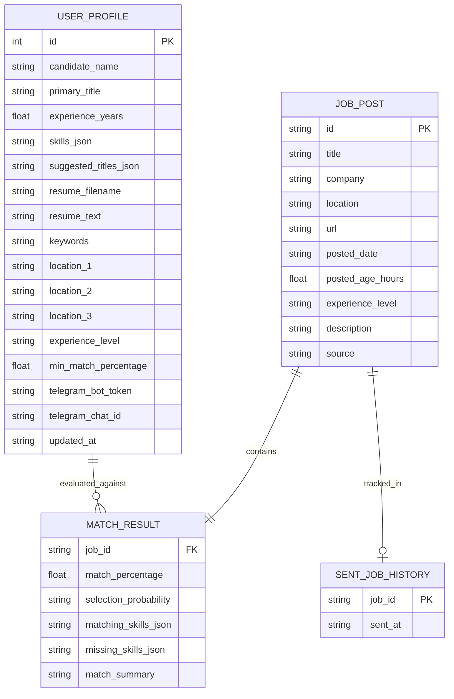
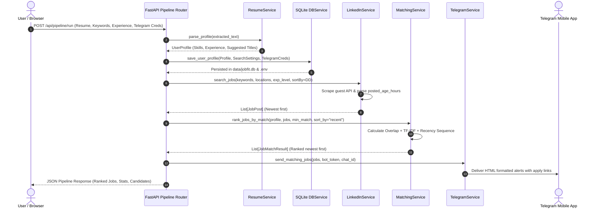
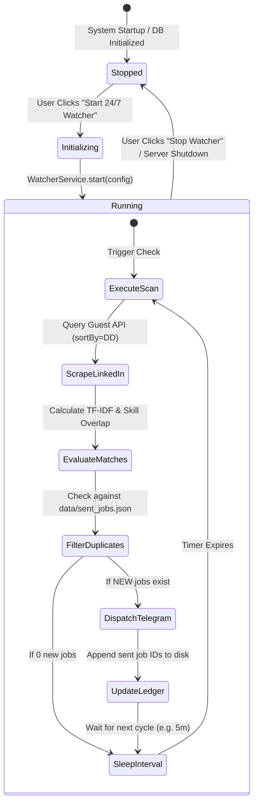

## Project: JobFit AI - Intelligent LinkedIn Job Matcher & Autonomous Telegram Notifier

---

## Table of Contents
1. [Introduction](#1-introduction)
   - 1.1 Purpose
   - 1.2 Document Conventions
   - 1.3 Intended Audience
   - 1.4 Project Scope
   - 1.5 Definitions, Acronyms, and Abbreviations
2. [Overall Description](#2-overall-description)
   - 2.1 Product Perspective
   - 2.2 System Architecture Overview
   - 2.3 Product Features Summary
   - 2.4 User Classes and Characteristics
   - 2.5 Operating Environment & Tech Stack
   - 2.6 Design and Implementation Constraints
   - 2.7 Assumptions and Dependencies
3. [External Interface Requirements](#3-external-interface-requirements)
   - 3.1 User Interfaces (Web Dashboard)
   - 3.2 Hardware Interfaces
   - 3.3 Software Interfaces
   - 3.4 Communications Interfaces
4. [System Features & Functional Requirements](#4-system-features--functional-requirements)
   - 4.1 Module 1: Resume Ingestion & Parsing Engine
   - 4.2 Module 2: Skill Extraction & Role Inference Engine
   - 4.3 Module 3: LinkedIn Public Guest Job Harvester
   - 4.4 Module 4: ATS Matching & Selection Probability Calculator
   - 4.5 Module 5: Real-Time Telegram Dispatcher
   - 4.6 Module 6: 24/7 Autonomous Background Watcher Daemon
   - 4.7 Module 7: Lightweight SQLite Persistence & Auto-Fill Engine
5. [Data Models & Storage Specifications](#5-data-models--storage-specifications)
   - 5.1 Entity Relationship Diagram
   - 5.2 SQLite Schema Specifications
   - 5.3 JSON State Formats
6. [Non-Functional Requirements](#6-non-functional-requirements)
   - 6.1 Performance Requirements
   - 6.2 Reliability & Fault Tolerance
   - 6.3 Security & Privacy Requirements
   - 6.4 Maintainability & Extensibility
   - 6.5 Zero-Cost Operational Constraint
7. [System Workflows & Diagrams](#7-system-workflows--diagrams)
   - 7.1 End-to-End Pipeline Sequence Diagram
   - 7.2 Background Watcher Loop State Machine
8. [Verification & Acceptance Criteria](#8-verification--acceptance-criteria)

---

## 1. Introduction

### 1.1 Purpose
This Software Requirements Specification (SRS) defines the complete functional, technical, behavioral, and non-functional specifications for **JobFit AI**. JobFit AI is an automated, AI-assisted career companion built with Python and FastAPI that enables job seekers to extract actionable technical profiles from resumes, harvest active job postings from LinkedIn via zero-cost public guest endpoints, compute rigorous Applicant Tracking System (ATS) match percentages, and autonomously broadcast top-ranked, newest-first job leads directly to a Telegram bot.

### 1.2 Document Conventions
- **Requirement Priorities:** High, Medium, Low.
- **Keywords:** The keywords *MUST*, *MUST NOT*, *REQUIRED*, *SHALL*, *SHOULD*, and *MAY* are to be interpreted as described in RFC 2119.
- **Math & Formulas:** Match percentages, semantic cosine similarities, and post-age estimations are expressed using KaTeX mathematical notations.

### 1.3 Intended Audience
This document is authored for:
- Software Engineers and Backend Architects maintaining the FastAPI application.
- QA and Automation Engineers designing integration and unit verification suites.
- End Users and Developers looking to self-host, containerize, or deploy the solution.

### 1.4 Project Scope
The scope of JobFit AI encompasses:
- Local, privacy-first parsing of user resumes formatted in PDF, DOCX, or plain text without paid cloud dependencies.
- Automated extraction of over 60 industry-standard technical competencies and experience tenure estimation.
- Web harvesting of LinkedIn active job postings without authenticated credentials, using free public guest search protocols with multi-location, experience level (`f_E`), and date descending (`sortBy=DD`) filtering.
- Hybrid qualification scoring synthesizing:
  1. Direct Technical Skill Overlap (Jaccard-based set operations).
  2. Sublinear TF-IDF N-gram Cosine Vector Similarity.
  3. Role Title and Seniority Alignment.
  4. Experience level compatibility penalties and bonuses.
- Automatic dispatching of formatted, emoji-enriched job leads with direct LinkedIn application URLs to a Telegram Bot using the free Telegram Bot API.
- A 24/7 autonomous background daemon (`WatcherService`) that continuously monitors LinkedIn, performs on-disk deduplication, and pings Telegram only when brand-new postings appear.
- Zero-configuration persistent local storage using SQLite (`data/jobfit.db`) and `.env` synchronization to eliminate repetitive manual data entry.

### 1.5 Definitions, Acronyms, and Abbreviations
| Term | Definition |
| :--- | :--- |
| **ATS** | Applicant Tracking System; automated software used by employers to screen and rank candidate resumes. |
| **TF-IDF** | Term Frequency - Inverse Document Frequency; numerical statistic measuring the relevance of a word in a text corpus. |
| **Cosine Similarity** | Angular metric between two multi-dimensional vectors determining semantic closeness. |
| **Guest Scraper** | HTTP client querying publicly exposed read-only web endpoints without user session cookies or paid developer keys. |
| **SQLite** | Embedded, serverless, zero-configuration relational database engine bundled with standard Python. |
| **Deduplication** | The mechanism of storing dispatched entity identifiers to prevent redundant user alerts. |

---

## 2. Overall Description

### 2.1 Product Perspective
JobFit AI operates as a self-contained, micro-architected web application. It integrates seamlessly into candidate job search workflows by replacing tedious manual job board browsing with automated, algorithmic profile matching and real-time push notifications.

```
+-----------------------------------------------------------------------------------+
|                                 JOBFIT AI PLATFORM                                |
|                                                                                   |
|   +--------------------+     +---------------------+     +--------------------+   |
|   |  Resume Ingestion  | --> |  Skill Extraction   | --> | ATS Scoring Engine |   |
|   |  (PDF, DOCX, TXT)  |     |  & Title Inference  |     | (TF-IDF & Overlap) |   |
|   +--------------------+     +---------------------+     +--------------------+   |
|                                                                     |             |
|   +--------------------+     +---------------------+                v             |
|   |  SQLite Database   | <-> | 24/7 Watcher Daemon | <-> +--------------------+   |
|   |  (data/jobfit.db)  |     | (Auto Deduplication)|     | Real-time Telegram |   |
|   +--------------------+     +---------------------+     | Delivery Service   |   |
|                                                          +--------------------+   |
+-----------------------------------------------------------------------------------+
```

### 2.2 System Architecture Overview
The platform consists of seven decoupled layers:
1. **Presentation Layer:** Responsive single-page dashboard rendered with Jinja2, Tailwind CSS, FontAwesome icons, and Vanilla ES6 JavaScript.
2. **REST API Routing Layer:** Modular FastAPI routers handling resume parsing, job querying, match computations, Telegram testing, background watcher lifecycle, and database settings.
3. **Parsing & Inference Layer:** PyPDF and python-docx text stream extractors coupled with regex token analyzers and heuristic tenure estimators.
4. **Scraping Layer:** Asynchronous `httpx` HTTP client harvesting LinkedIn guest HTML structures with fallback resilient sample models.
5. **Matching Engine:** Vectorized mathematical models computing ATS alignment scores.
6. **Background Execution Layer:** Asynchronous daemon loop leveraging `asyncio.create_task` for persistent 24/7 polling.
7. **Storage Layer:** SQLite relational engine (`data/jobfit.db`) and JSON state files (`sent_jobs.json`).

### 2.3 Product Features Summary
- **Zero-Cost Constraint:** Operates without paid APIs (no RapidAPI subscriptions, no LinkedIn Developer keys, no paid database hosting).
- **Unlimited Scanning by Default:** Disables artificial job search caps, querying across all available pagination pages.
- **Experience Level Tuning:** Filters jobs by seniority (`all`, `entry`, `associate`, `mid_senior`, `senior`, `director`, `internship`) to eliminate mismatched recommendations.
- **Newest-First Recency Priority:** LinkedIn `sortBy=DD` ordering coupled with post-age sorting ensures freshest jobs occupy top ranks.
- **Complete State Persistence:** Saves candidate resume, search keywords, locations, experience level, match thresholds, and Telegram bot credentials in SQLite so reloading the page requires zero repetitive typing.

### 2.4 User Classes and Characteristics
- **Active Job Seekers:** Software engineers and technical professionals looking for real-time alerts on matching openings.
- **Passive Candidates:** Professionals running background monitoring to be notified only when exceptionally high-match roles (e.g. >80%) emerge.
- **System Administrators / Self-Hosters:** Users running JobFit AI locally on laptops, home labs, or virtual private servers (VPS).

### 2.5 Operating Environment & Tech Stack
- **Operating Systems:** Windows 10/11, Ubuntu 20.04/22.04 LTS, macOS 12+.
- **Runtime:** Python 3.10 - 3.12.
- **Core Framework:** FastAPI 0.115+, Uvicorn ASGI Server.
- **Data Science:** Scikit-Learn 1.5+, NumPy 2.0+.
- **HTML Parsing & Network:** HTTPX 0.27+, BeautifulSoup4 4.12+, LXML.
- **Document Processing:** PyPDF 4.3+, Python-Docx 1.1+.
- **Database:** SQLite 3.35+ (standard library).
- **Frontend Assets:** Tailwind CSS (CDN), FontAwesome 6 (CDN).

---

## 3. External Interface Requirements

### 3.1 User Interfaces (Web Dashboard)
The web dashboard is delivered via responsive HTML5/CSS3 at `http://127.0.0.1:8000`:
- **Step 1 (Resume & Profile):** Drag-and-drop resume upload zone, manual fallback text area, detected skills pills preview, and a SQLite persistence banner with manual `Save Settings` button.
- **Step 2 (LinkedIn Job Search):** Target role keyword input, 3-to-4 clickable suggested role pills, up to 3 optional location inputs, Experience Level selector (`f_E`), and Minimum Match Percentage range slider.
- **Step 3 (Telegram Delivery):** Telegram Bot Token input (password masked), Telegram Chat ID input, `Test Bot Ping` trigger, `Save Credentials` trigger, and an `Auto-Send ALL Matches` checkbox.
- **Control Bar:** Primary `Start 24/7 Background Auto-Watcher` button and secondary `Instant Scan Once` button.
- **Live Watcher Card:** Real-time metrics card reporting watcher state (`RUNNING`/`STOPPED`), checks executed, total jobs dispatched, last check timestamp, and a `Stop Watcher` button.
- **Results Explorer:** Real-time client-side filter input, sequence ordering dropdown (`Newest First` vs `Highest Match`), and ranked cards with recruiter match insights, matching/missing skills, and direct LinkedIn application buttons.

### 3.2 Hardware Interfaces
- Minimum: 1 vCPU, 512 MB RAM, 100 MB free disk space.
- Recommended: 2 vCPU, 1 GB RAM, 500 MB free disk space.

### 3.3 Software Interfaces
- **LinkedIn Public Guest Search API:** `GET https://www.linkedin.com/jobs-guest/jobs/api/seeMoreJobPostings/search`
- **Telegram Bot API:** `POST https://api.telegram.org/bot{token}/sendMessage`
- **SQLite Database:** Local connection to `data/jobfit.db`.

---

## 4. System Features & Functional Requirements

### 4.1 Module 1: Resume Ingestion & Parsing Engine
- **FR-1.1:** The system SHALL accept resume files via `multipart/form-data` in `.pdf`, `.docx`, and `.txt` formats.
- **FR-1.2:** For `.pdf` files, the system SHALL extract text streams using `pypdf.PdfReader` across all document pages.
- **FR-1.3:** For `.docx` files, the system SHALL extract paragraph and table text using `docx.Document`.
- **FR-1.4:** If file reading yields zero non-whitespace characters, the system SHALL raise HTTP 400 Bad Request.
- **FR-1.5:** The system SHALL support fallback raw resume text provided via direct string input.

### 4.2 Module 2: Skill Extraction & Role Inference Engine
- **FR-2.1:** The system SHALL match document text against a predefined lexicon of over 60 industry-standard technical keywords using word boundary regex (`\b{skill}\b`).
- **FR-2.2:** The system SHALL estimate candidate experience tenure by analyzing patterns such as `(\d+)\+?\s*years? of experience` and default to 2.0 years if unspecified.
- **FR-2.3:** The system SHALL generate between 3 and 4 suggested target job titles by combining candidate seniority with primary technical skills (e.g. `Senior FastAPI Developer`, `Python Cloud Engineer`).

### 4.3 Module 3: LinkedIn Public Guest Job Harvester
- **FR-3.1:** The system SHALL scrape active job postings from LinkedIn's guest search endpoint without requiring user session authentication.
- **FR-3.2:** The scraper SHALL support up to three optional search locations. If all are omitted, it SHALL default to worldwide/unrestricted search.
- **FR-3.3:** The scraper SHALL append `&sortBy=DD` to the search URL to prioritize newly posted jobs.
- **FR-3.4:** The scraper SHALL map selected experience levels to LinkedIn's official `f_E` parameter:
  - `internship` -> `1`
  - `entry` -> `2`
  - `associate` -> `3`
  - `mid_senior` -> `4`
  - `senior` -> `4,5`
  - `director` -> `5,6`
- **FR-3.5:** The scraper SHALL calculate post age in hours from human-readable strings (e.g. `Just now` = 0.1h, `2 hours ago` = 2.0h, `1 day ago` = 24.0h).
- **FR-3.6:** If LinkedIn guest endpoints return zero postings due to transient network rate limits, the scraper SHALL supply fallback active sample tech postings to guarantee continuous pipeline reliability.

### 4.4 Module 4: ATS Matching & Selection Probability Calculator
- **FR-4.1:** The system SHALL calculate a composite match percentage $P_{match} \in [5.0, 98.0]$ for each job posting:
  $$P_{raw} = (S_{skill} \times 50.0) + (S_{tfidf} \times 35.0) + (S_{title} \times 15.0) + B_{skills} + \Delta_{exp}$$
  Where:
  - $S_{skill} = \frac{|Skills_{resume} \cap Skills_{job}|}{|Skills_{job}|}$
  - $S_{tfidf} = \text{Cosine Similarity}(\vec{V}_{resume}, \vec{V}_{job})$
  - $S_{title} = \text{Word Overlap Ratio}(Title_{resume}, Title_{job})$
  - $B_{skills} \in \{0.0, 5.0, 10.0\}$ (Bonus for $\ge 2$ or $\ge 4$ matching skills)
  - $\Delta_{exp}$ represents experience alignment bonus ($+5.0\%$) or mismatch penalty ($-10.0\%$ to $-15.0\%$).
- **FR-4.2:** The system SHALL assign a qualitative Selection Probability rating:
  - $P_{match} \ge 78.0\%$: **Very High**
  - $65.0\% \le P_{match} < 78.0\%$: **High**
  - $50.0\% \le P_{match} < 65.0\%$: **Moderate**
  - $P_{match} < 50.0\%$: **Low**
- **FR-4.3:** The system SHALL rank qualified jobs using the user-specified sequence:
  - Default (`recent`): Sorted primarily by post age ascending (newest first), with ties broken by match percentage descending.
  - Alternate (`match`): Sorted primarily by match percentage descending.

### 4.5 Module 5: Real-Time Telegram Dispatcher
- **FR-5.1:** The system SHALL dispatch matching job cards to Telegram using HTTP POST requests to `https://api.telegram.org/bot{token}/sendMessage`.
- **FR-5.2:** Messages SHALL be formatted in HTML mode containing:
  - Top Match status emoji badge.
  - Formatted rank, job title, company name, location, post date, and experience level.
  - Exact match percentage and selection likelihood.
  - Matching skills and missing skills lists.
  - Actionable ATS recruiter tip.
  - Hyperlinked direct LinkedIn application URL.
- **FR-5.3:** The dispatcher SHALL enforce a 350ms delay between consecutive messages to comply with Telegram rate limits.

### 4.6 Module 6: 24/7 Autonomous Background Watcher Daemon
- **FR-6.1:** The system SHALL maintain a background task loop managed by `WatcherService` executing at user-configured intervals (e.g. 5, 10, 15, 30, 60 minutes).
- **FR-6.2:** The daemon SHALL query LinkedIn for matching postings, evaluate scores, and filter results against a persistent set of dispatched job IDs in `data/sent_jobs.json`.
- **FR-6.3:** The daemon SHALL transmit ONLY brand-new job postings to Telegram, eliminating duplicate notifications.
- **FR-6.4:** The daemon SHALL continue running autonomously in the background even if the client browser or dashboard tab is closed.
- **FR-6.5:** The daemon state SHALL be initialized on FastAPI startup and cleanly terminated on application shutdown.

### 4.7 Module 7: Lightweight SQLite Persistence & Auto-Fill Engine
- **FR-7.1:** The system SHALL maintain an embedded SQLite database at `data/jobfit.db`.
- **FR-7.2:** The database SHALL persist candidate name, extracted skills, suggested titles, resume text, resume filename, search keywords, locations, experience level, threshold score, and Telegram credentials.
- **FR-7.3:** When the dashboard is accessed, the frontend SHALL automatically retrieve persisted records via `GET /api/profile/saved` and pre-populate all input controls.
- **FR-7.4:** The system SHALL automatically synchronize updated Telegram credentials to both SQLite and the workspace `.env` file upon save, blur, or test execution.

---

## 5. Data Models & Storage Specifications

### 5.1 Entity Relationship Diagram



### 5.2 SQLite Schema Specifications
```sql
CREATE TABLE IF NOT EXISTS user_profile (
    id INTEGER PRIMARY KEY,
    candidate_name TEXT,
    primary_title TEXT,
    experience_years REAL DEFAULT 2.0,
    skills_json TEXT DEFAULT '[]',
    suggested_titles_json TEXT DEFAULT '[]',
    resume_filename TEXT,
    resume_text TEXT,
    keywords TEXT,
    location_1 TEXT,
    location_2 TEXT,
    location_3 TEXT,
    experience_level TEXT DEFAULT 'mid_senior',
    min_match_percentage REAL DEFAULT 55.0,
    telegram_bot_token TEXT,
    telegram_chat_id TEXT,
    updated_at TEXT
);
```

### 5.3 JSON State Formats
- **Watcher Config (`data/watcher_config.json`):** Stores running profile dictionary, search parameters, interval minutes, and target Telegram credentials.
- **Sent Jobs Ledger (`data/sent_jobs.json`):** JSON array of string job IDs dispatched to Telegram (e.g. `["lk-398207", "3982060606", ...]`).

---

## 6. Non-Functional Requirements

### 6.1 Performance Requirements
- **NFR-1.1:** Resume parsing and skill detection SHALL complete within 500ms for documents under 5 MB.
- **NFR-1.2:** ATS match calculations across 50 job postings SHALL execute in under 100ms using vectorized Scikit-Learn TF-IDF transforms.
- **NFR-1.3:** Single-page dashboard initial load time SHALL be under 1.0 second on local loopback connections.

### 6.2 Reliability & Fault Tolerance
- **NFR-2.1:** If LinkedIn returns HTTP 429 Too Many Requests or anti-bot challenge pages, the application SHALL gracefully switch to structured sample tech postings without raising 500 server crashes.
- **NFR-2.2:** Network timeouts for external scraping SHALL be capped at 6.0 seconds per batch to prevent hung worker threads.
- **NFR-2.3:** Background watcher cycles encountering unhandled network exceptions SHALL log the error, enter normal sleep, and resume execution automatically on the subsequent interval.

### 6.3 Security & Privacy Requirements
- **NFR-3.1:** All resume parsing SHALL take place entirely in local memory; no candidate documents or extracted PII SHALL be transmitted to third-party cloud AI vendors without explicit configuration.
- **NFR-3.2:** Telegram Bot Tokens SHALL be treated as sensitive credentials and masked in the UI with HTML password input elements.
- **NFR-3.3:** Cross-Origin Resource Sharing (CORS) middleware SHALL allow standard local origin requests while blocking unauthorized external origins.

### 6.4 Maintainability & Extensibility
- **NFR-4.1:** Codebase SHALL adhere strictly to PEP 8 standards with comprehensive type hinting (`typing.Optional`, `typing.List`, `typing.Dict`).
- **NFR-4.2:** Data interchange contracts SHALL be enforced using Pydantic models.

### 6.5 Zero-Cost Operational Constraint
- **NFR-5.1:** The system SHALL operate entirely on free-tier or open-source infrastructure:
  - Python / FastAPI / SQLite (Open Source)
  - LinkedIn Guest Endpoints (Zero API cost)
  - Telegram Bot API (100% Free via @BotFather)

---

## 7. System Workflows & Diagrams

### 7.1 End-to-End Pipeline Sequence Diagram



### 7.2 Background Watcher Loop State Machine



---

## 8. Verification & Acceptance Criteria

| ID | Test Scenario | Expected Outcome | Verification Method |
| :--- | :--- | :--- | :--- |
| **TC-01** | Resume Parsing (PDF/DOCX/TXT) | Extracts candidate name, $\ge 5$ skills, experience years, and $\ge 3$ suggested roles. | Automated API Verification (`/api/resume/upload`) |
| **TC-02** | Hybrid Matching Algorithm | Scores $\ge 70\%$ for aligned job, generates selection likelihood, matching and missing skills. | Automated Pipeline Engine (`MatchingService`) |
| **TC-03** | Recency Prioritization | Verifies that job posted `Just now` or `1 hour ago` is ranked #1 over older postings. | Automated Pipeline Engine (`MatchingService`) |
| **TC-04** | Experience Filtering | Mismatched senior roles are penalized or excluded when searching under `entry` experience. | Automated Pipeline Engine (`LinkedInService`) |
| **TC-05** | SQLite Database Persistence | Persists profile, resume, and credentials to `data/jobfit.db`; restores upon dashboard load. | Automated Database Service (`DBService`) |
| **TC-06** | Telegram Credential Sync | Saves Bot Token and Chat ID to SQLite and `.env`; verifies connection with ping message. | Automated Telegram Service (`TelegramService`) |
| **TC-07** | Background Watcher Lifecycle | Starts background loop, tracks checks, filters duplicate IDs, stops cleanly without crash. | Automated Watcher Service (`WatcherService`) |
| **TC-08** | Zero Cost Constraint | Entire system runs and delivers alerts without requiring paid API keys or subscriptions. | Architectural Inspection |

---
